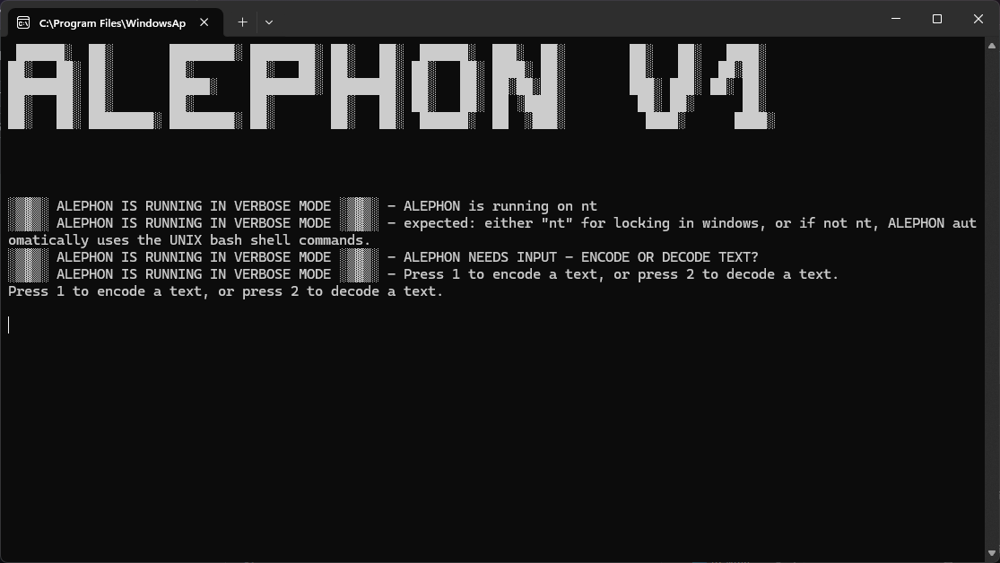
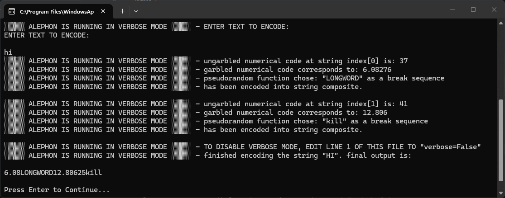
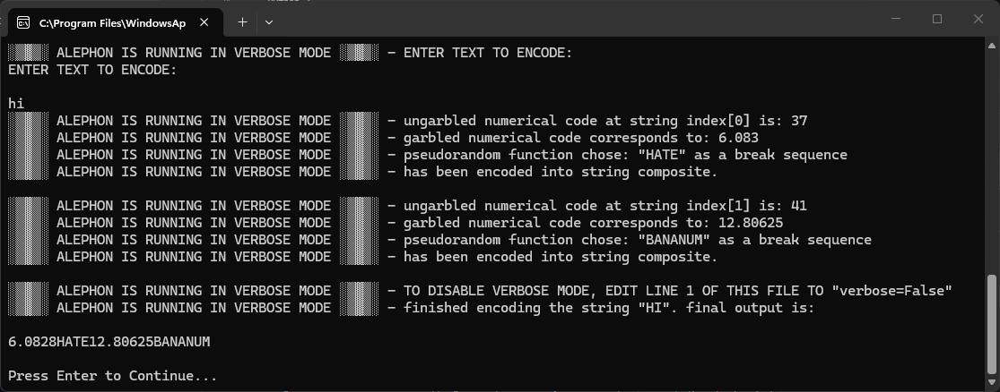

# ALEPHON

ALEPHON is a text encoder and decoder written in Python.

It transforms text into numerical sequences using prime numbers, square roots, and character positions. Randomized decimal precision and separator sequences make the encoded output less predictable in appearance. It is easy to decode when you have this reference though.

**ALEPHON is an obfuscation project, not a secure encryption system.**

## Features

- Encode and decode text through a command-line interface.
- Convert supported characters into numerical values using a predefined prime-number mapping.
- Apply character-position-based mathematical transformations.
- Randomize the precision of encoded numbers.
- Insert randomly selected separators, including numbers and arbitrary words for poisoning your string.
- Customize the character mappings and separator sequences. (Manually by changing the Source Code)
- optional verbose output for nerds.

## How It Works

Each supported character is assigned a prime number.

During encoding, ALEPHON calculates the square root of that prime number and multiplies the result by the character's position in the message. The resulting number is formatted with a randomly selected decimal precision and followed by a random separator.

During decoding, ALEPHON removes the known separators and reverses the mathematical transformation to recover the original characters.

The current version supports uppercase letters, spaces, and the punctuation marks `. , ? !`. Lowercase input is converted to uppercase.

For Example, the same string will most likely not have the same result if you run it twice in a row, but they both decode to the original letter.

It is a crude attempt at cryptography, but more of a proof of concept. It might just be the best obfuscation ever if you configure the 3 indexes in the Source Code in the right way.

## Requirements

- Python 3
- No third-party dependencies

ALEPHON uses only modules from the Python standard library.

## Usage

1. Download or clone the repository.
2. Run the Python script.
3. Select the encoder or decoder from the menu.
4. Enter your text or an ALEPHON-encoded message.

The program displays the result directly in the terminal.

## Customization

The following lists can be modified in the source code:

- `letterIndex` — Supported characters.
- `numberIndex` — Corresponding prime-number values.
- `breakCharacterIndex` — Possible separator sequences.

`letterIndex` and `numberIndex` must contain matching entries in the same order for encoding and decoding to work correctly.

Messages encoded with modified mappings or separators may not be compatible with other configurations.

## Security Notice

ALEPHON is intended for experimentation, learning, and demonstrating Python programming.

Although its output can be difficult to interpret visually, the mathematical transformation is reversible and does not provide cryptographic security.

**Do not use ALEPHON to protect passwords, personal information, or other sensitive data.**

## License

This project is distributed under the GNU General Public License v3.0 (GPL-3.0).
